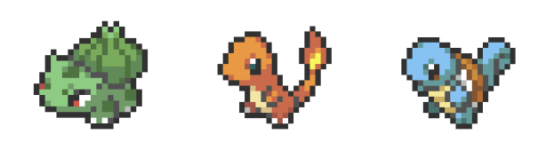
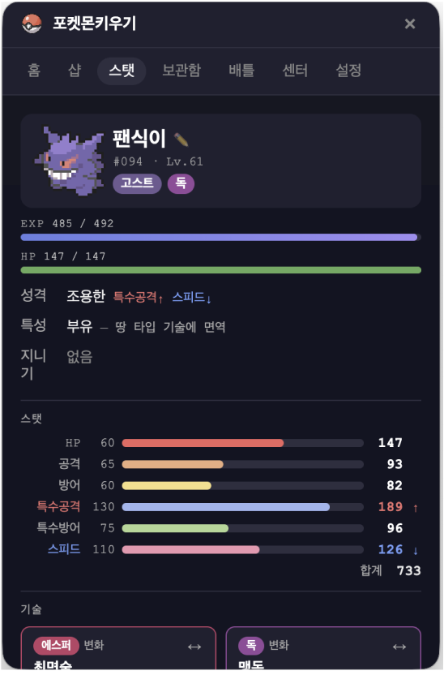

# 포켓몬 키우기 — Desktop Pet

데스크탑 위에 항상 떠 있는 픽셀아트 포켓몬을 키우는 생산성 앱.
집중모드와 배틀로 포인트를 모아 파트너 포켓몬을 성장시킨다.

> macOS · Windows 동시 지원 · Electron 기반

<p align="center">
  
</p>

---

## 📥 설치 — 다운로드해서 바로 실행

[Releases](https://github.com/ESeungJun/poketmon_idle/releases/latest)에서 운영체제에 맞는 파일 하나를 받는다.

| OS | 파일 | 사용법 |
|----|------|--------|
| macOS (Apple 칩 · Intel 공용) | `poketmon-idle-x.y.z-mac-universal.dmg` | 열어서 앱을 응용 프로그램 폴더로 옮긴 뒤 실행 |
| Windows 10/11 | `poketmon-idle-x.y.z-win-setup.exe` | 인스톨러 실행 |

- macOS 앱은 Apple 서명·공증을 받아 보안 경고나 터미널 명령 없이 바로 열린다.
- Windows는 서명하지 않은 빌드라 SmartScreen이 막으면 **추가 정보 → 실행**을 누른다.

소스를 받아 직접 빌드하려면 아래 빠른 시작을 따른다.

---

## ⚡ 빠른 시작 — 한 줄 복붙으로 프로덕션 앱 실행

Node.js 18+ / npm / Git 만 설치되어 있으면, 아래 명령어 한 줄을 터미널에 복붙하면 **클론 → 의존성 설치 → 프로덕션 빌드 → 앱 실행**까지 자동으로 진행된다.

### 🪟 Windows (cmd / PowerShell)

```cmd
git clone https://github.com/ESeungJun/poketmon_idle.git && cd poketmon_idle && npm install && npm run build && start "" "release\win-unpacked\poketmon-idle.exe"
```

### 🍎 macOS (Terminal / zsh)

```bash
git clone https://github.com/ESeungJun/poketmon_idle.git && cd poketmon_idle && npm install && npm run build && xattr -cr release/mac-universal/poketmon-idle.app && open release/mac-universal/poketmon-idle.app
```

빌드 완료 후 격리속성(quarantine) 제거 + 앱 바로 실행까지 한 번에 처리. `release/mac-universal/poketmon-idle.app` 파일을 그대로 사용한다.

> 첫 실행 시 의존성 설치 + 빌드(universal x64+arm64 + ad-hoc 사이닝)까지 **3~7분 정도** 걸린다.
>
> 다음부터는 `release/mac-universal/poketmon-idle.app`을 Finder에서 직접 더블클릭하거나, 원하면 `/Applications`로 끌어다 놓고 사용하면 된다.

단계별 설명·옵션·문제 해결이 필요하면 아래 [상세 가이드](#-설치-및-실행-사용자-가이드)를 참고.

---

## 📦 설치 및 실행 (사용자 가이드)

git에서 소스를 받아 직접 빌드하여 실행할 수 있다.

### 0. 사전 준비물

| 항목 | 최소 버전 | 확인 방법 |
|------|-----------|-----------|
| Node.js | 18 이상 (LTS 권장) | `node -v` |
| npm | 9 이상 | `npm -v` |
| Git | 최신 | `git --version` |

> Node.js가 없다면 [nodejs.org](https://nodejs.org)에서 LTS 버전 설치.

### 1. 저장소 클론

```bash
git clone git@github.com:ESeungJun/poketmon_idle.git
# 또는 HTTPS
git clone https://github.com/ESeungJun/poketmon_idle.git

cd poketmon_idle
```

### 2. 의존성 설치

```bash
npm install
```

> Electron 다운로드가 포함되어 있어 첫 설치는 수 분 걸릴 수 있다.

### 3. 실행 방법 — 두 가지 중 택1

#### A. 개발 모드로 바로 실행 (가장 빠름, 권장)

```bash
npm run dev
```

- Vite 개발 서버(`localhost:5173`) + Electron 창이 함께 켜진다.
- 코드 수정 시 HMR(Hot Reload)로 즉시 반영.
- 종료: 터미널에서 `Ctrl+C`.

#### B. 프로덕션 빌드 후 앱처럼 실행

```bash
npm run build
```

빌드 결과물 위치:

| OS | 산출물 경로 | 사용법 |
|----|-------------|--------|
| macOS | `release/mac-universal/poketmon-idle.app` | Finder에서 더블클릭 또는 `open` 명령으로 실행 |
| Windows (압축X) | `release\win-unpacked\poketmon-idle.exe` | `.exe` 더블클릭 |
| Windows (인스톨러) | `release\포켓몬키우기 Setup 1.0.0.exe` | 인스톨러 실행 |

> **macOS 보안 경고**: 서명되지 않은 빌드라 처음 실행 시 "확인되지 않은 개발자" 또는 "손상되었습니다" 경고가 뜰 수 있다.
> 격리속성을 제거하고 열기:
> ```bash
> xattr -cr release/mac-universal/poketmon-idle.app && open release/mac-universal/poketmon-idle.app
> ```
> 또는 `시스템 설정 → 개인정보 보호 및 보안`에서 "확인 없이 열기" 클릭.
>
> 빌드한 Mac이 아닌 **다른 Mac으로 옮겨서 실행하는 것은 권장하지 않는다** — ad-hoc 서명이라 다른 환경에서 Gatekeeper가 거부할 수 있다. 다른 Mac에서는 [Releases](https://github.com/ESeungJun/poketmon_idle/releases/latest)의 서명된 dmg를 받아 쓴다.

### 4. 처음 실행 시

1. Panel 창에서 **스타터 3종(이상해씨 / 파이리 / 꼬부기)** 중 하나 선택
2. 스타터 선택 후 작은 Pet 창이 화면 위에 떠다니기 시작
3. Pet 창은 **드래그로 어디든 이동 가능**, 항상 다른 창 위에 표시

### 5. 데이터 저장 위치

진행상황은 자동 저장된다 (`electron-store` 사용).

| OS | 경로 |
|----|------|
| macOS | `~/Library/Application Support/poketmon-idle/config.json` |
| Windows | `%APPDATA%\poketmon-idle\config.json` |

데이터 초기화는 앱 내 **설정 탭 → 데이터 초기화** 또는 위 파일 직접 삭제.

---

## 🎮 기능 상세 안내

### 창 구성

| 창 | 크기 | 역할 |
|----|------|------|
| **Pet 창** | 100~160px (진화 단계별) | 투명·항상 위, 포켓몬이 화면을 배회. 드래그로 이동 가능 |
| **Panel 창** | 380×580px | 모든 조작 UI (집중모드 / 스탯 / 배틀 / 보관함 / 상점 / 설정) |

두 창은 IPC로 실시간 상태 동기화. 스타터 미선택 상태에서는 Pet 창이 표시되지 않는다.

<p align="center">
  
  <br/>
  <em>Panel 창 스탯 탭 — 종족값/실제 스탯, 성격·특성·지니기, 보유 기술 표시</em>
</p>

---

### ⏱ 집중모드 (포모도로 타이머)

- 집중 시간 **1~120분** 설정 (기본 25분)
- **wall-clock 기반** — 탭 전환·백그라운드 상태에서도 정확
- 집중 중에는 파트너 포켓몬이 **수면(sleeping) 애니메이션**으로 전환
- **포인트 획득**
  - 집중 1분당 **+2pt**
  - 집중모드 1회 완료 시 **+75pt 보너스**
- 중단해도 경과 시간만큼 비례 지급

---

### 🐣 포켓몬 시스템

#### 스타터 3종 (1세대)
이상해씨 · 파이리 · 꼬부기 — 모두 도트 픽셀아트로 렌더링.

#### 레벨 & 진화
- 포인트 누적으로 자동 레벨업 (레벨 n에 필요한 누적 포인트 = n² × 4)
- **진화 조건 도달 시 진화 연출(3초)** 후 자동 진화
  - 이상해씨 → 이상해풀 → 이상해꽃
  - 파이리 → 리자드 → 리자몽
  - 꼬부기 → 어니부기 → 거북왕
- 진화 시 **닉네임·성격·특성·개체값(IV)·기술·EV 모두 유지**

#### 스탯 시스템 (3세대 이후 공식)
```
HP   = ⌊(2×base + IV + ⌊EV/4⌋) × level / 100⌋ + level + 10
기타 = ⌊(2×base + IV + ⌊EV/4⌋) × level / 100⌋ + 5      (× 성격 보정)
```
- **성격(Nature)**: 6종 스탯에 ±10% 보정
- **개체값(IV)**: 0~31 랜덤 (캡처/생성 시 결정)
- **노력치(EV)**: 비타민으로 +10씩, 스탯당 최대 252 / 합계 510

#### 기술 학습
- 레벨업 시 **7세대(울트라썬·울트라문) 기술배치(learnset)** 기반 자동 습득
- 슬롯 4개 초과 시 교체 선택 가능
- **TM(기술머신)**: 상점에서 구매하여 호환 포켓몬에게 학습

---

### ⚔️ 배틀 시스템

- **야생 포켓몬 조우**: 레벨 기반 풀에서 랜덤 출현
- **턴제 배틀**: 스피드 비교 → 기술 선택 → 데미지 계산 → 후속 효과
- 구현된 요소:
  - **18타입 상성 테이블** (`getTypeEffectiveness`)
  - **물리/특수/변화** 카테고리 구분
  - **명중률** 계산
  - **상태이상**: 독 · 마비 · 화상 · 잠듦 · 얼음
  - **랭크업 변화**: 능력↑↓ (1~6단계)
  - **날씨**: 쾌청 · 비 (각 5턴, 불꽃·물 기술 위력 보정)
  - **고정 데미지 기술**: 용의분노(40) · 나이트헤드(레벨만큼)

---

### 🎯 포획 시스템 (몬스터볼)

| 볼 종류 | 가격 | 보정값 |
|---------|------|--------|
| 🔴 몬스터볼 | 30pt | ×1.0 |
| 🔵 슈퍼볼 | 80pt | ×1.5 |
| 🟡 하이퍼볼 | 150pt | ×2.0 |

- HP가 낮을수록, 상태이상이 걸려있을수록 포획률 상승
- 포획 성공 시 **보관함(Box)**으로 이동
- **볼 투척 애니메이션** 포함 (`BallCanvas`)

---

### 📦 보관함 (Box)

- 잡은 포켓몬 전체 목록 표시
- **파트너 교체** — 데스크탑 위에 띄울 포켓몬 변경
- **닉네임 변경**
- **놓아주기** (방생)

---

### 🛒 상점 (Shop)

#### 진화의 돌
- ⚡ **천둥의돌** (500pt) — 피카츄 → 라이츄

#### 지니기 아이템
> 현재는 장착과 스탯 화면 표시까지만 동작하고, 배틀 중 효과는 아직 구현 전이다.

| 아이템 | 가격 | 효과 (예정) |
|--------|------|------|
| 🔮 생명의구슬 | 500 | 기술 위력 ×1.3, 매턴 최대HP 1/10 감소 |
| 👓 구애안경 | 400 | 특수공격 ×1.5 (한 기술만 사용) |
| 🧣 구애스카프 | 400 | 스피드 ×1.5 (한 기술만 사용) |
| 🍖 먹다남은음식 | 300 | 매턴 HP 1/16 회복 |
| 🔔 조개껍질방울 | 250 | 준 대미지 1/8 만큼 HP 흡수 |
| 🩹 기합의띠 | 250 | 풀HP에서 기절타를 HP1로 버팀 |
| 🖤 검은진흙 | 200 | 독타입 전용 회복 |
| 🤓 박식안경 | 200 | 특수기술 위력 ×1.1 |
| 👻 저주의부적 | 150 | 고스트 기술 ×1.2 |
| 💜 독바늘 | 150 | 독 기술 ×1.2 |

#### 비타민 (EV 강화 · 각 20pt / +10 EV)
❤️ 맥스업(HP) · 🥩 타우린(공격) · 🪨 사포닌(방어) · 🧪 리보플라빈(특공) · 💊 키토산(특방) · ⚗️ 알칼로이드(스피드)

#### 기술머신(TM) — 30종+
TM01 힘껏펀치 · TM06 맹독 · TM11 쾌청 · TM13 냉동빔 · TM24 10만볼트 · TM26 지진 · TM29 사이코키네시스 · TM35 화염방사 · TM50 대폭발 · TM52 기합구슬 · TM65 악의파동 · TM71 스톤에지 외 다수.

---

### 🎨 픽셀아트 & 애니메이션

- **도트 그래픽 19종** — 포켓몬 공식 도트를 바탕으로 픽셀 그리드 데이터로 변환해 사용
- **수면 도트** — 공식 도트를 AI로 잠자는 모습으로 변환한 뒤 코드로 바꾸고, 변환 중 튀는 픽셀·이상한 색은 도트 편집 화면(아래 미리보기 서버)에서 한 칸씩 직접 수정
- 도트가 없는 종은 **PokeAPI 스프라이트** CDN 사용
- 상태별 애니메이션: `idle` · `happy` · `sleeping` · `evolving`
- HTML Canvas + `image-rendering: pixelated`로 선명한 도트 렌더링

#### 픽셀아트 미리보기 서버 (개발자용)
```bash
cd pixel-art-source
node generate-preview.js   # http://localhost:3131
```
픽셀 hover 시 좌표·색상키 표시. anims 파일 수정 후 새로고침으로 즉시 확인.

---

## 🛠 기술 스택

| 항목 | 내용 |
|------|------|
| 런타임 | Electron 40 |
| UI | React 18 + Vite 5 |
| 상태관리 | Zustand 4 |
| 영구저장 | electron-store 8 |
| 렌더링 | HTML Canvas (`imageRendering: pixelated`) |
| 패키징 | electron-builder 26 |

---

## 📂 프로젝트 구조

```
poketmon_idle/
├── electron/
│   ├── main.js          # 메인 프로세스: 창 생성, IPC, 배회/드래그 로직
│   └── preload.js       # contextBridge → window.electronAPI
├── src/
│   ├── App.jsx          # 라우팅: ?view=pet / ?view=panel
│   ├── store/
│   │   └── useStore.js  # Zustand 전역 상태
│   ├── data/
│   │   ├── pokemon.js          # 종 데이터, 스탯 공식, 기술 시스템
│   │   ├── battleEngine.js     # 배틀 순수 로직 (데미지·상태이상·포획)
│   │   └── typeChart.js        # 18타입 상성 테이블
│   └── components/
│       ├── Pet/
│       │   ├── PetCanvas.jsx        # 캔버스 애니메이션 루프
│       │   ├── pokemonDraw.js       # 픽셀아트 렌더러
│       │   └── {1,2,3,4,5,6,7,8,9}-anims.js  # 도트 데이터
│       ├── Panel/
│       │   ├── Panel.jsx            # 탭 레이아웃
│       │   ├── PomodoroTimer.jsx    # 집중모드 타이머
│       │   ├── PointDisplay.jsx     # 포인트 / 레벨 표시
│       │   ├── PokemonStats.jsx     # 스탯 / 기술 / EV 관리
│       │   ├── StarterSelect.jsx    # 스타터 선택 화면
│       │   ├── Box.jsx              # 보관함
│       │   └── Settings.jsx         # 설정
│       └── Shop/
│           ├── Shop.jsx             # 상점 UI
│           ├── BallCanvas.jsx       # 볼 투척 애니메이션
│           └── items.js             # 아이템 카탈로그
├── pixel-art-source/    # 도트 원본·미리보기 도구
└── scripts/             # 빌드·헬퍼 스크립트
```

---

## 🧑‍💻 개발 (Contributing)

### 브랜치 전략
```
master  ← 안정 릴리즈 (production, 직접 push 불가)
dev     ← 개발 메인 (직접 push 불가)
feature/<기능명>  ← 작업 브랜치
```

### feature 브랜치 생성 헬퍼
```bash
bash scripts/setup-hooks.sh        # 최초 1회 — git hooks 설치
bash scripts/new-feature.sh <name> # dev에서 feature 브랜치 생성
```

작업 후 push → GitHub에서 **dev로 PR 생성** → 머지.

### 사용 가능한 npm 스크립트

| 스크립트 | 설명 |
|----------|------|
| `npm run dev` | Vite + Electron 동시 실행 (개발용) |
| `npm run vite` | Vite 단독 실행 |
| `npm run build` | 프로덕션 빌드 (`release/` 생성) |
| `npm run preview` | 빌드된 결과물 미리보기 |

자세한 내부 규칙은 [`CLAUDE.md`](./CLAUDE.md) 참고.

---

## 🗺 로드맵

| Phase | 내용 | 상태 |
|-------|------|------|
| Phase 1 | 기반 완성 (스타터 3종, 레벨·진화, 집중모드, IPC 보안) | ✅ 완료 |
| Phase 2 | 진화형·야생 포켓몬 픽셀아트 완성 | ✅ 완료 |
| Phase 3 | 야생 포켓몬 조우 & 배틀 시스템 | ✅ 완료 |
| Phase 4 | 포획 시스템, 보관함, 파트너 교체 | ✅ 완료 |
| Phase 5 | 밸런스 조정, 버그 수정, 패키징 최적화 | 🔄 진행 중 |

자세한 내용은 [ROADMAP.md](./ROADMAP.md).

---

## ❓ 문제 해결 (FAQ)

**Q. `npm install` 도중 Electron 다운로드 실패**
사내망/프록시 환경이면 `ELECTRON_MIRROR=https://npmmirror.com/mirrors/electron/ npm install` 시도.

**Q. macOS에서 "손상되어 열 수 없습니다" 경고**
```bash
xattr -cr release/mac-universal/poketmon-idle.app
```
실행 후 다시 열기.

**Q. Pet 창이 안 보임**
스타터 미선택 상태이거나 화면 밖으로 드래그됨. Panel 창에서 스타터 선택 또는 설정에서 위치 초기화.

**Q. 데이터를 깔끔히 지우고 싶음**
앱 종료 후 위 "데이터 저장 위치"의 `config.json` 삭제.

**Q. 포인트가 너무 늦게 쌓임**
집중모드는 1분당 2pt + 완료 시 75pt가 정상 설계값이다. 배틀 승리·포획으로도 포인트 획득 가능.

---

## 📜 라이선스 & 크레딧

- 포켓몬 명칭·도트·기술명·게임 화면 이미지(포켓몬센터 등): © Nintendo / Game Freak / The Pokémon Company. 학습·취미 목적의 비상업 팬 프로젝트이며, 배포 파일 없이 소스만 공개한다.
- 코드: 개인 프로젝트 (`ESeungJun/poketmon_idle`)
