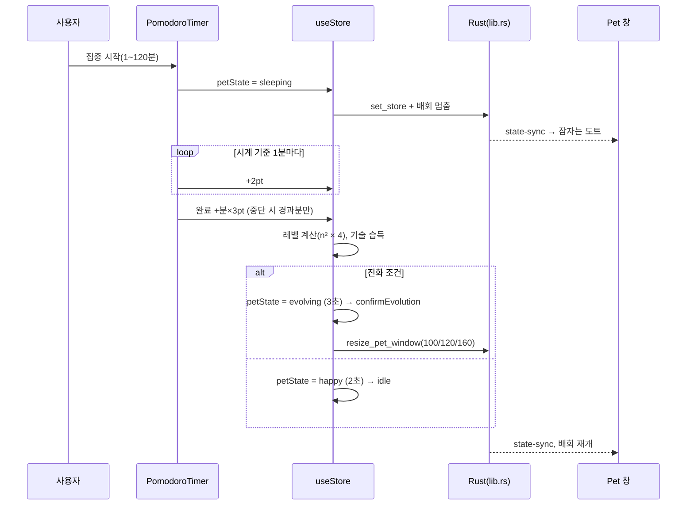
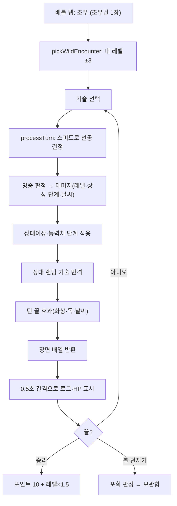
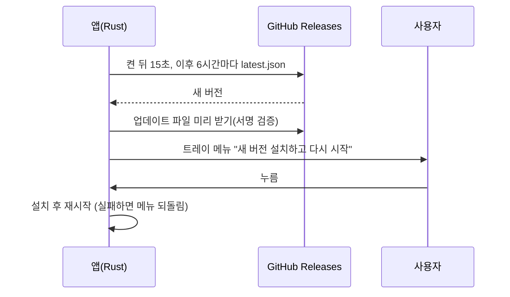

# 포켓몬 키우기 구현도

> 2026-11-05에 `dev` 브랜치 코드(v1.1.0 내용)에서 복원했다. 기존 문서 [README](../README.md) · [ROADMAP](../ROADMAP.md) · [DEVLOG](../DEVLOG.md) · [CLAUDE.md](../CLAUDE.md) · [timeline.html](../timeline.html)은 그대로 두고 여기서 링크한다.

관련 문서: [기획서](기획서.md) · [설계서](설계서.md) · [결정기록](결정기록.md)

## 폴더·모듈 구조

```
poketmon_idle/
├─ src-tauri/
│  ├─ src/lib.rs             창 2개, 트레이, 저장소(config.json·키 허용 목록), 명령, 배회·드래그, 업데이트, Electron 데이터 이전
│  ├─ src/main.rs            진입점
│  ├─ tauri.conf.json        앱 이름·식별자·번들·CSP·업데이터
│  ├─ capabilities/default.json  권한
│  └─ Cargo.toml
├─ src/
│  ├─ main.jsx, App.jsx      진입, 창 종류(pet/panel) 라우팅, 펫 창 크기 조정
│  ├─ platform/tauri.js      Tauri 명령·이벤트 → window.electronAPI
│  ├─ store/useStore.js      Zustand: 포인트·아이템·펫 상태·배틀·포획
│  ├─ data/
│  │  ├─ pokemon.js          종 데이터, 스탯 공식, 기술·PP·야생 풀
│  │  ├─ battleEngine.js     데미지·상태이상·능력치 단계·날씨·processTurn·포획
│  │  └─ typeChart.js        18타입 상성
│  ├─ constants/typeColors.js
│  └─ components/
│     ├─ Pet/                PetCanvas, pokemonDraw, pixelArtRegistry, StaticPokemonSprite, *-anims.js(도트 19종)
│     ├─ Panel/              Panel(탭), PomodoroTimer, PointDisplay, PokemonStats, StarterSelect, Box, Battle, PokeCenter, Settings
│     └─ Shop/               Shop, items.js, BallCanvas, 볼 도트 3종
├─ pixel-art-source/         도트 원본 PNG(normal/sleep/item), convert.py, 미리보기 서버(generate-preview.js)
├─ scripts/                  dev.sh, new-feature.sh, setup-hooks.sh, check-pokemon-ko.js
├─ hooks/pre-push            master·dev 직접 push 차단
├─ .claude/                  pokemon-expert 에이전트, add-pokemon-sprite·verify-pokemon-ko 스킬, 승인 이름 목록
├─ .github/workflows/        build.yml(feature 브랜치 빌드 확인), release.yml(태그 릴리스)
└─ docs/                     스크린샷, 이 문서들
```

핵심 파일 링크: [src-tauri/src/lib.rs](../src-tauri/src/lib.rs) · [src/platform/tauri.js](../src/platform/tauri.js) · [src/store/useStore.js](../src/store/useStore.js) · [src/data/battleEngine.js](../src/data/battleEngine.js) · [src/data/pokemon.js](../src/data/pokemon.js) · [src/components/Pet/PetCanvas.jsx](../src/components/Pet/PetCanvas.jsx) · [src/components/Panel/PomodoroTimer.jsx](../src/components/Panel/PomodoroTimer.jsx) · [release.yml](../.github/workflows/release.yml)

## 주요 흐름

### 1. 집중 → 포인트 → 레벨업·진화



### 2. 야생 배틀 한 턴



### 3. 업데이트 (1.1.0~)



## 빌드·실행·배포

```bash
npm install
npm run dev          # Vite + Tauri 창 (Rust 필요). scripts/dev.sh는 기존 프로세스를 끄고 실행
npm run build        # 릴리스 빌드 (명시 요청 시에만, CLAUDE.md)
bash scripts/setup-hooks.sh          # pre-push 훅 설치(최초 1회)
bash scripts/new-feature.sh <이름>   # dev에서 feature 브랜치
cd pixel-art-source && node generate-preview.js   # 도트 미리보기 http://localhost:3131
```

- 브랜치: `master`(프로덕션) · `dev`(통합) 모두 직접 push 금지. `feature/*` → `dev` PR → 릴리스 때 `dev` → `master`.
- 코드 수정 뒤 PR 전 절차: 빌드 → 실행 확인 → 사용자 확인 → PR(CLAUDE.md).
- feature 브랜치를 push하면 `build.yml`이 서명 없는 dmg·exe를 Actions 결과물로 남긴다(Rust 없는 Mac용).
- 릴리스: `package.json`·`src-tauri/Cargo.toml` 버전을 올리고 `v<버전>` 태그 push → `release.yml`이 서명·공증된 universal dmg, NSIS exe, 업데이트 파일·서명·`latest.json`을 draft 릴리스로 올림 → Publish해야 자동 업데이트가 받는다.
- PR 머지 뒤 ROADMAP과 `timeline.html`을 함께 갱신한다(프로젝트 메모리).

## 버전·릴리스 현황

| 태그 | 날짜 | 주요 내용 |
|---|---|---|
| (태그 없음) | 2026-03-05 ~ 03-23 | Phase 1~5: 스타터·진화·집중모드, 배틀, 포획·보관함, 밸런스·패키징(Electron) |
| (태그 없음) | 2026-05-28 | README 설치 가이드, macOS dmg 흐름 제거하고 .app 직접 실행 |
| v1.0.0 | 2026-10-22 | 첫 공개 릴리스: 서명·공증된 macOS dmg, Windows exe (Electron) |
| v1.1.0 | 2026-11-05 | Electron → Tauri, 자동 업데이트. 태그는 있고 릴리스 워크플로는 대기 중(2026-11-05 확인) |

`dev`는 v1.1.0과 코드가 같고 버전 번호(`package.json`·`Cargo.toml`)만 1.0.0으로 남아 있다(`git diff master dev`).

## 앞으로 할 일

- 지니기 아이템 배틀 효과(README "아직 구현 전").
- 성격 데이터 공식 검증, 승인 이름 목록 재점검(개발 글).
- v1.1.0 릴리스 공개 확인, `master` 릴리스 커밋을 `dev`에 다시 합치기.
- ROADMAP에는 남은 미완료 항목이 없다.
