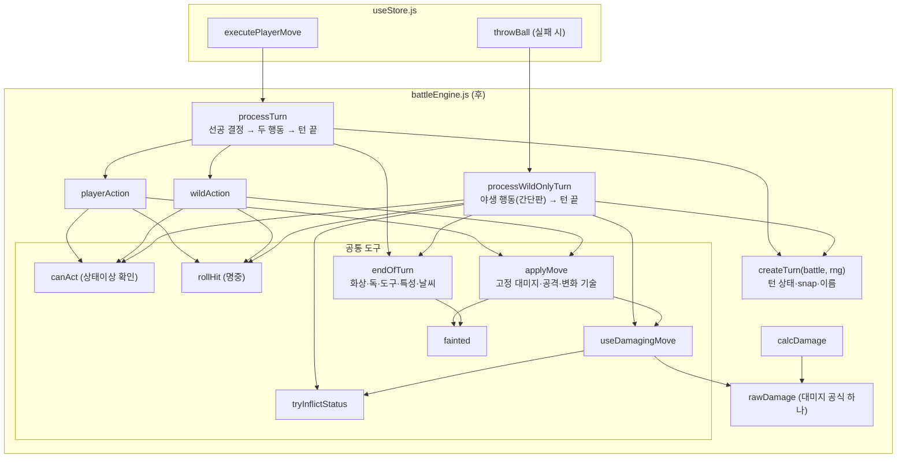

# 리팩토링: 배틀 엔진 턴 처리 정리 (2026-11-17)

이슈: [#65](https://github.com/ESeungJun/poketmon_idle/issues/65) · 관련 문서: [구현도](../구현도.md) · [설계서](../설계서.md)

원칙: 밖에서 보이는 동작은 그대로 둔다. 전투 결과(문구, HP, 상태이상, 능력치 단계, PP, 날씨, 보상 포인트), 저장 데이터 형식, 두 창 동기화 내용이 바뀌지 않는다. 버그를 찾아도 여기서 고치지 않고 맨 아래 "발견한 문제"에 적는다.

## 1. 왜 해야 하나

| 지금의 문제 | 근거 (master `d0bfbf6`) | 안 하면 생기는 비용 |
|---|---|---|
| 한 함수가 너무 길다 | `processTurn` 399줄(285~683). 안에 `processPlayerAction`(160줄)·`processWildAction`(130줄) 클로저와 턴 끝 처리가 같이 들어 있다 | 기술 하나를 더하려면 400줄을 다 읽어야 한다 |
| 같은 코드가 두 벌 | `processWildOnlyTurn`(145줄, 볼 실패 턴)이 야생 행동과 턴 끝 처리를 복사해 쓴다. 상태이상 확인, 명중 판정, 대미지, 부가 상태이상, 화상·독, 먹다남은음식, 빗속준비, 태양의힘, 날씨 카운트가 두 번씩 있다 | 한쪽만 고치고 다른 쪽을 잊는다. 실제로 볼 실패 턴에는 고정 대미지 기술과 능력치·날씨 기술이 빠져 있다(아래 "발견한 문제") |
| 대미지 공식이 네 곳 | `calcDamage`(159), 플레이어 공격(363~366), 야생 공격(517~518), 볼 실패 턴(766~767)에 `Math.floor(2 * level / 5) + 2 …` 가 따로 적혀 있다 | 공식을 바꾸면 네 곳을 같이 고쳐야 한다 |
| 난수를 갈아 끼울 수 없다 | 턴 함수 안에서 `Math.random` 을 바로 부른다 | 정해진 결과로 시험하려면 전역 `Math.random` 을 바꿔치기해야 한다 |
| 스토어 저장 줄 반복 | `useStore.js` 에 `set → saveToStore/saveMany → sendStateUpdate` 를 액션마다 손으로 잇는다(`saveToStore(` 19번, `saveMany(` 9번, `sendStateUpdate(` 21번). 배틀이 끝날 때 HP·PP 를 petStats 에 적는 코드도 두 벌(`advanceBattleFrame`, `fleeFromBattle`) | 저장이나 동기화 한쪽을 빠뜨리는 실수가 쉽다 |

## 2. 전·후 비교

| 항목 | 전 | 후 |
|---|---|---|
| `processTurn` | 399줄, 클로저 2개 + 턴 끝 처리 | 짧은 순서도(선공 결정 → 두 행동 → 턴 끝). 행동은 `playerAction`·`wildAction` 함수 |
| `processWildOnlyTurn` | 145줄, 야생 행동·턴 끝 처리 복사본 | 같은 도구(`canAct`·`rollHit`·`useDamagingMove`·`tryInflictStatus`·`endOfTurn`)를 불러 쓴다 |
| 턴 상태 | 함수마다 `curWild`·`curPlayer`·`curWeather`·`snap` 을 따로 만든다 | `createTurn(battle, rng)` 하나가 만든다. 양쪽은 `'player'`·`'wild'` 로 가리킨다 |
| 대미지 공식 | 4곳 | `rawDamage` 한 곳. `calcDamage`·플레이어·야생 대미지가 모두 이것을 쓴다 (반올림 순서는 지금과 똑같이 둔다) |
| 난수 | `Math.random` 직접 호출 | `processTurn(battle, move, rng = Math.random)`, `processWildOnlyTurn(battle, rng = Math.random)`. 기본값이 그대로라 부르는 쪽은 바꿀 것이 없다 |
| 스토어 | 액션마다 `set`·저장·동기화를 손으로 | `persist(set, patch, { sync })` 도우미. 배틀 결과 기록은 `withBattleResult` |
| 테스트 | 68개 (`battleEngine.test.js` 21개는 동작 예시) | + 배틀 특성 테스트 9개(시드 고정 난수로 6천 개 넘는 턴의 장면 전체·난수 호출 횟수를 스냅샷), 스토어 저장·동기화 특성 테스트 28개 |
| 공개 API | `processTurn`, `processWildOnlyTurn`, `calcDamage`, `calcCatchRate`, `buildWildBattler`, `buildPlayerBattler`, `generatePetStats`, `heldItemPowerMod`, `NATURES`, `STATUS_KO`, `WEATHER_KO` | 같다 (턴 함수 두 개에 마지막 인자 `rng` 만 더함) |

## 3. 전 설계도

```mermaid
flowchart TD
  subgraph store["useStore.js"]
    EPM["executePlayerMove"]
    TB["throwBall (실패 시)"]
  end
  subgraph engine["battleEngine.js (전)"]
    PT["processTurn 399줄"]
    PPA["processPlayerAction (클로저)<br/>상태 확인·명중·대미지 공식②·변화 기술"]
    PWA["processWildAction (클로저)<br/>상태 확인·명중·대미지 공식③·변화 기술"]
    EOT1["턴 끝 처리①<br/>화상·독·도구·특성·날씨"]
    PWO["processWildOnlyTurn 145줄<br/>상태 확인·명중·대미지 공식④<br/>턴 끝 처리② (복사본)"]
    CD["calcDamage (대미지 공식①)<br/>테스트에서만 씀"]
    CSA["checkStatusAction<br/>Math.random"]
  end
  EPM --> PT
  TB --> PWO
  PT --> PPA
  PT --> PWA
  PT --> EOT1
  PPA --> CSA
  PWA --> CSA
  PWO --> CSA
  PPA -.Math.random.-> PPA
  PWA -.Math.random.-> PWA
  PWO -.Math.random.-> PWO
```

## 4. 후 설계도



## 5. 단계별 계획

각 단계 끝에 `npm test`(특성 스냅샷 포함)와 `npm run vite:build` 를 돌리고, 공개 export 가 그대로인지 `git diff` 로 본 뒤 커밋한다. 커밋 하나가 되돌리기 지점이다.

| 단계 | 바꾸는 것 | 확인 |
|---|---|---|
| 0 | 특성 테스트 추가: 시드 고정 `Math.random` 으로 상황을 만들어 장면 전체 해시·난수 호출 횟수를 스냅샷. 입력은 얼려서(freeze) 엔진이 입력을 고치면 실패하게 | 리팩토링 전 코드로 스냅샷 생성. 일부러 값 하나를 바꾸면 실패하는지 확인(돌연변이 확인) |
| 1 | 턴 함수에 `rng` 인자(기본값 `Math.random`), `checkStatusAction` 도 `rng` 를 받게 | 스냅샷 그대로. `rng` 를 직접 넘긴 결과 = `Math.random` 을 바꿔치기한 결과 |
| 2 | `rawDamage` 로 공식 하나. `calcDamage` 와 세 공격 지점이 이를 쓴다 | 스냅샷 그대로 |
| 3 | `createTurn`·`canAct`·`rollHit`·`tryInflictStatus`·`fainted`·`applyMove`·`useDamagingMove`·`endOfTurn` 을 만들고 `processTurn` 을 그것으로 다시 짠다 | 스냅샷 그대로 |
| 4 | `processWildOnlyTurn` 이 같은 도구를 쓰게 | 스냅샷 그대로 |
| 5 | 스토어 특성 테스트(액션별 set·저장·동기화 순서 스냅샷)를 먼저 넣고, `persist`·`withBattleResult`·`scheduleHappyEnd` 로 바꾼다 | 스토어 스냅샷·`useStore.test.js` 통과 |
| 6 | 구현도 갱신, 이 문서에 실측 추가 | — |

## 6. 영향 범위

- 내부(바뀌는 파일): `src/data/battleEngine.js`, `src/store/useStore.js`, 새 테스트 `src/data/battleEngine.characterization.test.js` 와 스냅샷, `docs/`.
- 외부(부르는 쪽): `useStore.js` 의 `executePlayerMove`·`throwBall` 만 턴 함수를 부른다. 인자 순서·반환 모양이 같다. 화면 컴포넌트는 엔진을 직접 부르지 않는다.
- 데이터·설정: 저장 키, 저장 형식, `state-sync` 로 보내는 내용, Rust 쪽은 바뀌지 않는다.

## 7. 리스크와 되돌리는 법

| 리스크 | 막는 법 |
|---|---|
| 아픔나누기 HP 맞추기 식이 한 벌로 합쳐짐 | 전에는 플레이어가 쓸 때 자기 HP 에만 `Math.max(0, …)` 가 없었다. 두 HP 의 평균은 HP 가 0 이상이면 0 이상이라 결과가 같다(모든 HP 대입이 0 이상으로 자르므로 음수 HP 는 생기지 않는다). 돌연변이 확인에서도 차이가 없었다 |
| 난수를 부르는 순서·횟수가 달라져 결과가 바뀜 | 특성 스냅샷이 난수 호출 횟수와 장면 전체를 같이 본다. 순서가 바뀌면 거의 모든 상황에서 해시가 달라진다 |
| 반올림 순서가 달라짐 (플레이어: 상성 뒤 한 번 내림 → 보정 곱 → 다시 내림 / 야생: 상성·날씨를 곱하고 한 번 내림) | 두 계산을 각자 그대로 옮기고 곱하는 순서도 그대로 둔다. `calcDamage` 를 플레이어 계산에 쓰지 않는다(최소 1 처리 시점이 달라서 결과가 바뀔 수 있다) |
| 장면 객체 모양이 바뀜 | `snap` 이 만드는 객체 키·순서를 그대로 둔다. 스냅샷 해시는 키 순서와 상관없이 내용 전체를 본다 |
| 스토어 저장 호출이 달라짐 | `persist` 는 키가 하나면 `setStoreAsync`, 여럿이면 `setStoreMany` — 원래 각 액션이 쓰던 것과 같다. `set → 저장 → 동기화` 순서였던 곳에만 쓴다 |

되돌리기: 단계별 커밋이라 문제가 생긴 단계 커밋만 `git revert` 한다. 특성 테스트 커밋은 그대로 두어도 된다.

## 8. 기대 효과 (측정할 것)

| 지표 | 전 | 목표 |
|---|---|---|
| `battleEngine.js` 줄 수 | 845 | 줄어듦 |
| 가장 긴 함수 | `processTurn` 399줄 | 80줄 이하 |
| `processWildOnlyTurn` | 145줄 | 50줄 이하 |
| 대미지 공식 위치 | 4 | 1 |
| 상태이상 확인·명중·상태이상 걸기·턴 끝 처리 사본 | 각 3·3·5·2벌 | 각 1벌 |
| `useStore.js` 줄 수 | 734 | 줄어듦 |
| 테스트 | 68개 | 68 + 특성 테스트 |

## 9. 발견한 문제 (이번에 고치지 않음)

- 볼 실패 턴(`processWildOnlyTurn`)은 고정 대미지 기술(용의분노·나이트헤드)을 쓰면 아무 일도 일어나지 않는다. 일반 턴에서는 대미지가 들어간다.
- 볼 실패 턴에서 야생이 변화 기술을 쓰면 상태이상만 처리한다. 능력치 기술(울음소리 등), 날씨 기술(비바라기), 광합성·잠자기·아픔나누기는 "사용했다" 문구만 나오고 효과가 없다.
- 볼 실패 턴에는 야생 쪽 화상·독 턴 끝 피해가 없다(플레이어 쪽만 있다).
- 같은 조건에서 플레이어와 야생의 대미지 반올림이 다르다. 플레이어는 상성까지 곱해 한 번 내림한 뒤 보정을 곱해 다시 내림하고, 야생은 상성·날씨를 곱해 한 번만 내림한다.
- 야생의 광합성은 날씨와 상관없이 최대 HP 의 1/2 을 회복한다(플레이어는 맑음 2/3, 비 1/4).
- 야생의 특성(엽록소 제외)·지닌 도구는 대미지에 쓰이지 않는다(야생은 지닌 도구가 없다).
- 배틀 로직 일부(포획 판정·연출 프레임 `throwBall`, 조우 `startWildBattle`, 프레임 진행 `advanceBattleFrame`)가 스토어 안에 있다 → 백로그 이슈로 남긴다.

## 10. 결과 (실측, 2026-11-17)

| 지표 | 전 (`d0bfbf6`) | 후 | 목표 |
|---|---|---|---|
| `battleEngine.js` 줄 수 | 845 | 694 (−151) | 줄어듦 ✓ |
| `processTurn` | 399줄 | 21줄 | 80줄 이하 ✓ |
| `processWildOnlyTurn` | 145줄 | 32줄 | 50줄 이하 ✓ |
| 엔진에서 가장 긴 함수 | `processTurn` 399줄 | `useStatusMove` 66줄 | — |
| 대미지 공식 위치 | 4 | 1 (`rawDamage`) | 1 ✓ |
| 상태이상 확인·명중·상태이상 걸기·턴 끝 처리 사본 | 3·3·5·2벌 | 각 1벌 (`canAct`·`rollHit`·`tryInflictStatus`·`endOfTurn`) | 각 1벌 ✓ |
| 턴 함수 안 `Math.random` 직접 호출 | 17 | 0 (`rng` 인자) | — |
| `useStore.js` 줄 수 | 734 | 686 (−48) | 줄어듦 ✓ |
| `useStore.js` 의 `saveToStore(` / `saveMany(` / `sendStateUpdate(` | 19 / 9 / 21 | 5 / 6 / 12 (나머지는 `persist` 20곳) | — |
| 테스트 | 68개 | 105개 (배틀 특성 9 + 스토어 특성 28) | — |

확인한 방법
- 특성 스냅샷은 리팩토링 전 코드(`fc567f7`)에서 만들었고, 단계마다(`c2a52ca`·`3f19cba`·`df33365`·`47865c5`) 그대로 통과했다. 스냅샷 파일은 그 뒤로 바뀌지 않았다.
- 스냅샷이 실제로 차이를 잡는지 돌연변이로 확인했다: 광합성 회복량, 야생 광합성 회복량, 얼음 녹을 확률, 마비 확률, 턴 끝 'selecting' 표시, 볼 실패 턴에 야생 화상·독 넣기, 볼 실패 턴 상성 무효 장면의 phase 를 각각 바꾸면 실패했다. 차이가 없던 것은 결과가 같은 변경뿐이었다(아픔나누기 `max(0)`, 쓰러짐 확인 순서 — 둘이 동시에 0 이 되는 경우가 없다, 공격 기술의 잠듦 턴 수 — 공격 기술 중 잠듦을 거는 것이 없다).
- 스토어 특성 스냅샷은 스토어를 고치기 전(`dcbd277`)에 만들었고 `0666b1e` 뒤에도 그대로 통과했다.
- 단계마다 `npm test` 와 `npm run vite:build` 통과.
- 앱을 띄워 직접 싸워 보는 확인(`npm run dev`)은 하지 않았다. 화면 코드는 바뀌지 않았고, 엔진·스토어 출력이 스냅샷으로 같음을 확인했다.
