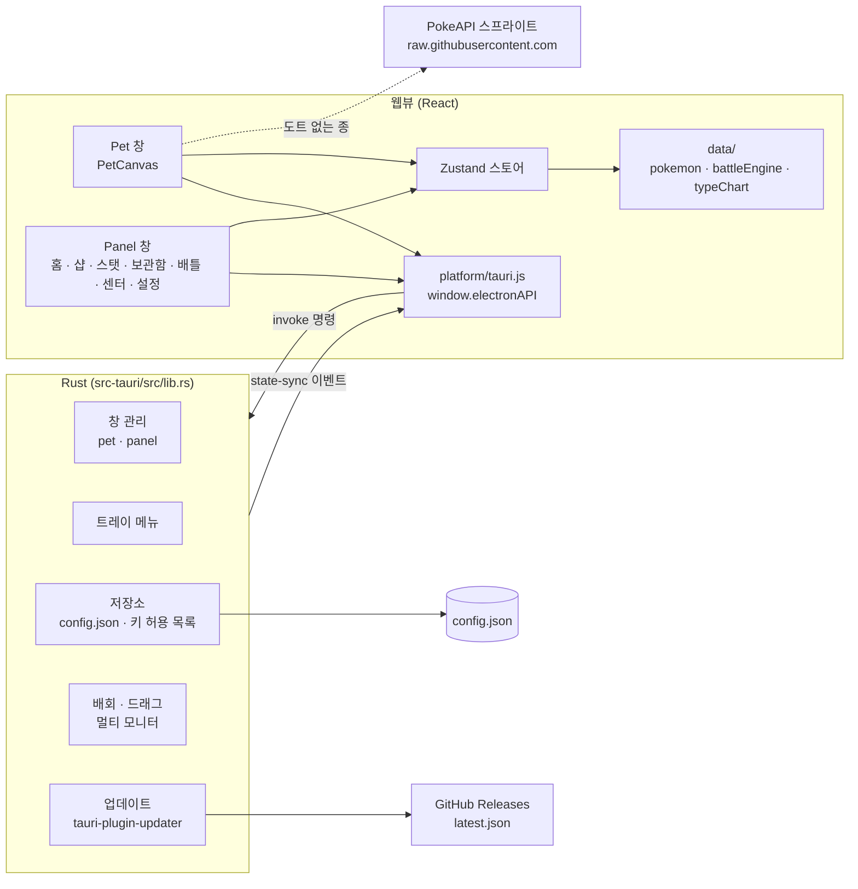

# 포켓몬 키우기 설계서

> 2026-11-05에 `dev` 브랜치 코드(v1.1.0 내용)와 git 히스토리에서 복원했다.

관련 문서: [기획서](기획서.md) · [구현도](구현도.md) · [결정기록](결정기록.md)

## 기술 스택과 고른 이유

| 영역 | 고른 것 | 이유 (근거) |
|---|---|---|
| 데스크톱 셸 | Tauri 2 (Rust + 시스템 웹뷰) | 1.0.0까지는 Electron이었다. 설치 파일이 macOS 198MB → 4MB, Windows 92MB → 1.4MB로 줄었다(ROADMAP, `782fc19`) |
| UI | React 18 + Vite 5 | 처음부터 썼다(`7fb49ad`). Tauri 전환 때 화면 코드는 그대로 두었다 |
| 상태 | Zustand 4 (`src/store/useStore.js`) | 두 창이 같은 상태를 나눠 쓴다 |
| 저장 | `config.json` 한 파일, Rust가 직접 읽고 씀 | Electron 시절 electron-store와 같은 형식이라 데이터를 그대로 옮길 수 있다(`src-tauri/src/lib.rs`) |
| 렌더링 | HTML Canvas + `image-rendering: pixelated` | 도트를 코드(그리드 데이터)로 그린다 |
| 포켓몬 데이터 | 직접 만든 JS 데이터(`src/data/`) + PokeAPI로 검증 | 이름은 PokeAPI `ko`, 기술은 7세대(USUM) 기준(CLAUDE.md) |
| 업데이트 | `tauri-plugin-updater` + GitHub 릴리스 `latest.json` | 1.1.0부터. 미리 받아 두고 트레이 메뉴에서 설치(`b79c070`) |
| 배포 | GitHub Actions(`release.yml`, `build.yml`) + GitHub Releases | `v*` 태그로 서명·공증된 dmg와 NSIS exe를 draft 릴리스로 |

### Electron → Tauri 비교 (근거가 있는 항목만)

| 항목 | Electron (1.0.0) | Tauri (1.1.0) |
|---|---|---|
| macOS 설치 파일 | 198MB | 4MB |
| Windows 설치 파일 | 92MB | 1.4MB |
| 저장 데이터 | electron-store `config.json` | 같은 형식, 첫 실행 때 자동 이전 |
| 자동 업데이트 | 없음 | 있음 |
| 웹뷰 | 번들 크로미움 | macOS WebKit · Windows WebView2 |

출처: ROADMAP Phase 5, README, `782fc19`. 다른 후보(예: Electron 유지 비용 비교)는 기록이 없다.

## 전체 아키텍처

- 창은 두 개다. Pet 창(투명·장식 없음·항상 위, 100~160px)과 Panel 창(380×580).
- 화면 코드는 `window.electronAPI`만 부른다. `src/platform/tauri.js`가 Electron 시절 preload와 같은 모양으로 Tauri 명령·이벤트를 감싼다.
- 한 창에서 상태가 바뀌면 Rust를 거쳐 `state-sync` 이벤트로 다른 창에 알린다.
- Rust가 창마다 `window.__POKE_VIEW__`(`pet`/`panel`)를 넣고, `App.jsx`가 그걸로 화면을 고른다.

## 데이터 구조·저장소·외부 API

### config.json 키 (Rust `ALLOWED_STORE_KEYS`, 15개)

| 키 | 내용 |
|---|---|
| `points`, `totalPointsEarned` | 현재·누적 포인트 |
| `purchasedItems`, `ownedTMs`, `equippedTool`, `ballInventory` | 산 물건, TM, 지닌 도구, 볼 |
| `pomodoroHistory`, `totalWorkMinutes`, `lastActiveTime` | 집중 기록 |
| `petState` | `idle` · `happy` · `sleeping` · `evolving` |
| `petSpeciesId`, `petName`, `petStats`, `petEVs` | 파트너 종·닉네임·스탯(성격·특성·IV·기술·HP·PP 등)·노력치 |
| `caughtPokemon` | 보관함 |

허용 목록 밖의 키는 읽지도 쓰지도 않는다.

위치: macOS `~/Library/Application Support/com.poketmonidle.app/config.json`, Windows `%APPDATA%\com.poketmonidle.app\config.json`.

### 메모리에만 있는 상태

- `wildBattle`: 야생·내 배틀러, 턴, 단계, 로그, 결과. 능력치 단계와 날씨도 여기 있고 배틀이 끝나면 사라진다.

### 공식

- 스탯(3세대 이후): `HP = ⌊(2×base + IV + ⌊EV/4⌋) × level / 100⌋ + level + 10`, 그 밖 `⌊…⌋ + 5`에 성격 보정 ±10%.
- 레벨 n 누적 포인트 = n² × 4.
- 데미지: 본가 공식을 간소화해 레벨 반영(`0bf74ca`).
- 포획: 본가 기반, HP·볼·종별 포획률·상태이상 보정(`0bf74ca`).

### 외부

| 대상 | 용도 |
|---|---|
| PokeAPI 스프라이트(`raw.githubusercontent.com`) | 도트가 없는 종 표시. CSP `img-src`에 이 주소만 허용 |
| PokeAPI 데이터 | 개발 중 이름 검증(`pokemon-expert` 에이전트, `/verify-pokemon-ko` 스킬). `scripts/check-pokemon-ko.js`는 편집 후 승인 목록(`.claude/approved-pokemon-names.json`)에 없는 이름을 경고하는 훅이다. 앱은 실행 중에 부르지 않는다 |
| GitHub Releases | `latest.json`, 업데이트 파일과 서명 |

## 플랫폼별 차이

| 항목 | macOS | Windows |
|---|---|---|
| 웹뷰 | WebKit | WebView2(크로미움) |
| 모든 데스크톱·전체 화면 위 표시 | `macOSPrivateApi` + `#[cfg(target_os = "macos")]` 가드 | 해당 없음 |
| 드래그 | 시작할 때 모든 데스크톱 표시를 끄고 끝나면 다시 켬 | 그대로 |
| 설치 파일 | universal dmg(Apple 칩·Intel 공용), Developer ID 서명 + 공증 | NSIS exe, 서명 없음 |
| 로컬 빌드 | 임시(ad-hoc) 서명, 그 Mac에서만 쓰기 권장 | 그대로 |
| 업데이트 설치 | `.app.tar.gz` 교체 | `installMode: passive` |

## 보안·권한

- 저장소 키 허용 목록(`ALLOWED_STORE_KEYS`)으로 화면이 아무 키나 쓰지 못하게 한다(Electron 시절 `e5baa17`에서 시작).
- 이벤트 리스너는 해제 함수를 돌려줘 창이 닫혀도 남지 않는다.
- CSP: `default-src 'self'`, 이미지는 `self`·`data:`·`raw.githubusercontent.com`만.
- 업데이트 파일은 Tauri 업데이터 서명 키로 검증한다. 공개 키는 `tauri.conf.json`, 비밀 키는 로컬과 GitHub Secrets에만 둔다.
- 릴리스 워크플로는 서명 인증서·공증 키를 macOS 패키징 단계에만 넘기고, 빌드 작업은 설치 스크립트 없이 의존성을 설치한다(`2712832`).
- `master`·`dev` 직접 push는 `hooks/pre-push`가 막는다.

## 알려진 한계

- 지니기 아이템은 장착·표시만 되고 배틀 효과는 없다(README).
- 성격 데이터는 공식 검증을 거치지 않았다(개발 글).
- 웹뷰가 OS마다 달라 CSS·캔버스 변경은 양쪽에서 확인해야 한다.
- Windows 설치 파일은 서명이 없어 SmartScreen이 막을 수 있다.
- 업데이트 서명 비밀 키를 잃으면 기존 설치본에 업데이트를 보낼 수 없다(CLAUDE.md).
- 1.0.0(Electron) 설치본은 자동 업데이트가 없어 1.1.0을 한 번 직접 설치해야 한다.
- 비상업 팬 프로젝트다. 포켓몬 IP의 권리는 원저작권자에게 있다.
